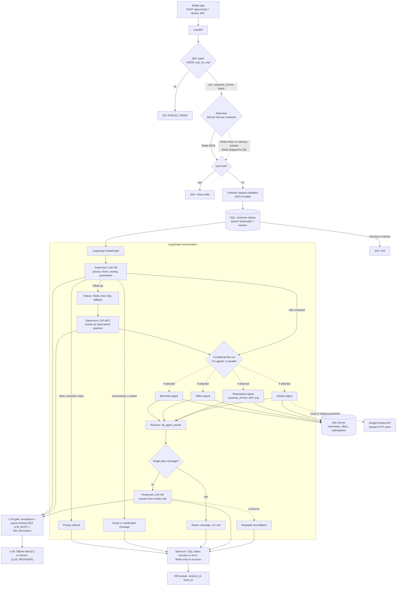

# MunomerchantAI — Technical Project Presentation Summary

> Source document for an AI slide generator and for the presenter.
> Every fact below was checked against the source code in this repository
> (branch `History_removefromresponse`, November 2026). Metrics come from test
> runs on a development machine, **not from production**.

---

## 0. Audit Summary

### 0.1 Components inspected

| Area | Files |
|---|---|
| API and security | `app/api/main.py`, `route/chat.py`, `route/auth.py`, `route/health.py`, `dependencies.py`, `jwt.py`, `schema/*.py` |
| Orchestration | `agent/graph/workflow.py` (LangGraph `StateGraph`), `agent/graph/state.py` |
| Supervisor and query planning | `agent/munomultiagent.py`, `Query_understanding/queryexpansion.py`, `guardrails/inputguardrails.py` |
| Agents | `merchant_agent.py`, `offer_agent.py`, `nearby_agent.py`, `redemption_agent.py`, `response_agent.py` |
| Tools (data access) | `tools/merchant_tool.py`, `offer_search_tool.py`, `near_bymerchant_tool.py`, `redemption_tool.py` |
| LLM | `agent/llm_provider.py`, `agent/llm_limits.py` |
| Data and cache | `database/database.py`, `services/customer_service.py`, `services/history_service.py`, `cache/redis_cache.py` |
| Operations | `utilities/log.py`, `utilities/server_settings.py`, `requirements.txt`, `.env` (variable names and non-secret values only) |
| Evaluation and tests | 5 datasets in `evaluation/datasets/`, 2 evaluator modules, 15 pytest files (271 tests) |

### 0.2 Major architecture findings

- **A supervisor plus four specialised agents**, orchestrated by a LangGraph `StateGraph`:
  - Conditional fan-out: only the agents the supervisor selects run, and they run in parallel.
  - A reducer (`operator.add`) merges their results.
  - One response agent writes the final answer.
- **Business data comes only from SQL Server**, through parameterised SQL queries. Distance and travel time come from the Google Routes API. The LLM never supplies business facts.
- **The customer's identity comes only from the signed JWT**, never from the request body or the LLM. Redemption queries always filter on that customer ID.
- **Redis** provides a per-customer rate limit and a cache of chat history. If Redis fails, rate limiting moves to in-memory counters and history falls back to SQL. **There is no cache of answers.**
- **The LLM provider can be switched** with `LLM_PROVIDER`: Ollama (currently active, `llama3.1`) or Gemini. LLM calls are limited by a semaphore with a wait timeout and a call timeout.
- **Not present:** RAG, vector database, embeddings or semantic search. There is also no separate "Route Agent"; route and distance questions are handled by the Nearby Agent through Google Routes.

### 0.3 Metrics verified (development environment)

- LLM throughput with local Ollama: about 11.6 calls per minute, and adding concurrency doesn't raise it (single-slot server).
- End-to-end latency with the real LLM for 1, 2 and 5 concurrent users.
- Rate limiting under 30 simultaneous requests: blocked and allowed counts, and the latency of blocked requests.
- Cross-customer privacy: 17 of 17 cases passed with the real LLM (earlier run).
- Fault-tolerance before-and-after measurements: Redis outage, LLM queue overload, and Google HTTP client reuse.

### 0.4 Could not be verified

- **Supervisor routing accuracy** on the 100-case dataset. No run result is stored, and today's run was blocked because the Ollama ngrok tunnel was offline.
- **Merchant-extraction accuracy:** the evaluator module exists, but no test calls it.
- **Response correctness and hallucination rate:** not measured.
- **Any production metric** (latency, usage, cost, business impact): the system isn't deployed yet.
- **The Gemini code path:** implemented, but not exercised by any test run.

### 0.5 Planned or incomplete

- Routing and extraction evaluation reports. The datasets `supervisor_multi_agent_tests.json` (60 cases) and `authorisation_test.json` (10 cases) aren't connected to any test.
- Token revocation and logout; refresh tokens.
- Containerisation, CI/CD, production observability (dashboards, alerts) and a production LangSmith policy (tracing is currently on, pointing at a dev project).
- Streaming responses, answer caching, and full-text or indexed merchant search.

---

## 1. Project Overview

### Slide title
**MunomerchantAI — A Conversational Assistant for Merchants, Offers and Rewards**

### Slide bullets
- **What it is:** a chat assistant for the rewards mobile app. Customers ask in plain English about merchants, current offers, nearby places and their own redemption history.
- **Value:** one question replaces several searches and screens.
- **Domain:** merchant rewards and loyalty (the "Get1Card" digital-savings platform).
- **Users:** the app's logged-in customers.
- **Capabilities:**
  - merchant details and search;
  - current offers and deals;
  - nearby places and travel time;
  - the customer's own redemption history;
  - follow-up questions.
- **Status:** pre-production. The backend API is complete and tested, and is being prepared for deployment behind the mobile app's chat tab.

### Detailed technical explanation
- **Backend:** a FastAPI service exposing `POST /api/v1/auth/login`, `POST /api/v1/chat`, `GET /api/v1/health` and `GET /api/v1/health/ready`.
- **Pipeline for each chat message:**
  1. Authenticate and rate-limit the request, and look up the customer.
  2. A LangGraph multi-agent graph runs the supervisor, then 0–4 specialised agents.
  3. A response agent writes the answer.
  4. The question and answer are stored as chat history.
- **Data sources:** an existing SQL Server database (merchant locations, offers, customers, redemptions) and the Google Routes API.
- **Suggested role title:** **AI Engineer (LLM Applications and Backend)**. The work covers agent design and prompting, orchestration, backend API, security, data access, evaluation and load testing.

### Suggested visual
The app's chat screen next to a short capability strip: four icons (Merchant, Offers, Nearby, Redemptions) plus a "follow-up" arrow.

### Facts to explain
- This is a production-bound system on real business data, not a toy demo. It isn't live yet, though, so all numbers in this deck come from tests.
- The mobile app sends only the message (plus GPS and optional dates). Everything about the customer comes from the login token.

### Interview Q&A
- **Q: Is this in production?**
  A: Not yet. The backend is complete and hardened for deployment. I'll only quote test results, not production figures.
- **Q: What exactly did you build?**
  A: The AI backend: the agent graph and prompts, the data tools and SQL, the API and security, the rate and LLM limits, the history handling, and the evaluation and load tests.

---

## 2. Business Problem

### Slide title
**Finding the Right Deal Takes Too Many Steps**

### Slide bullets
- **Merchant information is scattered:** address, phone, cuisine and website sit in different places.
- **Customers search offers manually,** by browsing lists instead of asking "BBQ deals in Tuscaloosa?"
- **"Did I redeem there last month?"** is hard to answer from the app today.
- **"How far is it?"** means switching to a maps app.
- **Natural follow-ups don't work** ("What about their phone number?") because every search starts from scratch.

### Detailed explanation

| Problem | Who has it | Why it matters | Impact (qualitative, not measured) |
|---|---|---|---|
| Fragmented merchant data | App customers | Details are spread across location, brand, category and cuisine records | More taps and time; customers may give up |
| Manual offer discovery | App customers | Offers depend on merchant, type, percentage, city and valid days | Relevant deals go unnoticed, so the programme delivers less value |
| Personal redemption history is hard to get | App customers, and support staff answering them | Needs a date range, merchant filter and totals | Support questions; low trust in the rewards |
| Distance and route need another app | App customers | Leaving the app breaks the experience | Lower engagement |
| No conversational context | App customers | Each search is stand-alone | Repeated typing; frustration |

> **No financial or usage statistics are available.** Treat the impacts above as *potential benefits* to measure after launch.

### Suggested visual
A "before" journey of 5–6 screens (search → filter → open merchant → open offers → maps → history) next to an "after" journey of 1 chat message.

### Facts to explain
Start from the customer's effort, not from AI. AI is the means; the goal is fewer steps to a correct, personal answer.

### Interview Q&A
- **Q: Why not just improve the search screens?**
  A: Questions combine dimensions: merchant, offer, distance and personal history in one sentence. A conversational interface handles combinations and follow-ups without building a screen for every combination.
- **Q: How will you prove the business value?**
  A: After launch, measure the share of chats answered without a fallback, time to answer, offer views after a chat, and support tickets about redemptions. None of these exist yet.

---

## 3. Solution

### Slide title
**Ask in Plain English, Get an Answer from Real Data**

### Slide bullets
- The customer types a question, the assistant works out **what kind of help** is needed, and it **asks the right specialists**.
- **Specialists:** Merchant, Offers, Nearby & Distance, and My Redemptions.
- **Answers are built only from the company's database** and Google Maps routes, never invented.
- **Follow-ups work:** "What about their phone number?" knows which merchant "their" means.
- **Privacy built in:** customers only ever see their own redemptions.

### Detailed explanation (non-technical)
1. **Understand:** a "supervisor" AI reads the question and decides:
   - Is it about our business?
   - Is it a follow-up?
   - Is it asking about someone else's data?
   - Which specialists are needed?
2. **Gather:** only the needed specialists run, at the same time. Each one reads the database (or Google Routes) with exact filters.
3. **Answer:** a writer AI combines what the specialists found into one short, friendly answer. If nothing is found, the assistant says so plainly rather than guessing.
4. **Remember:** the conversation is saved, so the next question can refer back to it.

### Representative user journey
1. *"Did I redeem at Dreamland BBQ last month, and do they have any deals now?"*
2. The supervisor selects the **Redemption** and **Offers** specialists and reads "last month" as a date range.
3. The Redemption specialist queries **only this customer's** redemptions at Dreamland BBQ for that month. At the same time, the Offers specialist queries Dreamland BBQ's offers that are live today.
4. The answer: *"You redeemed once at Dreamland BBQ on Oct 5 ($25.00, free dessert). They currently offer a free dessert with any entrée, valid until Dec 31."*
5. The follow-up *"How far is it?"* resolves to Dreamland BBQ and returns the driving time from the customer's GPS position.

### Suggested screenshot
The mobile chat tab showing the combined question above and its answer: two facts from two specialists in one reply. If possible, show the follow-up "How far is it?" underneath. That one screen demonstrates multi-agent routing, grounding and context together.

### Facts to explain
- "The AI decides *what to look up*. The database decides *what is true*."
- "Not business-related" questions get a polite scope message. Unclear references get a clarification question.

### Interview Q&A
- **Q: What happens if the database has no match?**
  A: The specialist returns a fixed message, for example "You have no redemptions from 2026-10-01 to 2026-10-31." When it's the only result, it's returned directly without calling the writer LLM, so the model can't invent anything.
- **Q: How does it handle "that place"?**
  A: The supervisor marks the question as a follow-up, loads recent history (Redis first, then SQL), and rewrites it as a stand-alone question. A deterministic check makes sure the rewrite no longer contains an unresolved reference; if it does, the assistant asks a clarifying question.

---

## 4. System Architecture

### Slide title
**Request Lifecycle: Secure Entry, Smart Routing, Grounded Answers**

### Slide bullets
- **Secure entry:** JWT login, per-customer rate limit, request validation.
- **Supervisor (LLM):** privacy check, routing, parameter extraction.
- **History, only for follow-ups:** Redis cache, then SQL.
- **LangGraph fan-out:** only the selected agents run, in parallel.
- **Data:** SQL Server (all business facts) and Google Routes (distance).
- **Response LLM:** combines results; readable text fallback if the LLM fails.
- **Protection:** LLM concurrency limit, wait timeout (503), call timeout.

### Architecture diagram (Mermaid)

### Detailed technical explanation
1. **Authentication** (`dependencies.py`, `jwt.py`):
   - The token is checked for signature (HS256 is fixed in code), expiry, issuer and audience.
   - Tokens without `exp`, `iss` or `aud` are rejected.
   - The `CustomerId` claim becomes an `int`, and that is the *only* source of the customer's identity.
2. **Rate limit** (`redis_cache.py`):
   - A fixed window using a Redis transaction: `SET NX EX`, then `INCR`, then `TTL`. The key is `chat_rate:{customer_id}`, and over-limit requests get 429 with `Retry-After`.
   - If Redis fails, an in-memory counter takes over and Redis is skipped for 30 seconds.
3. **Customer check** (`chat.py`): an active customer with an `ExternalID`. The ExternalID becomes the conversation's `session_id`.
4. **Supervisor** (`munomultiagent.py`):
   - One LLM call with structured output (the Pydantic `SupervisorDecision`).
   - Fields: `business_related`, `history_needed`, `other_customer_requested`, `selected_agent` (a Literal list of the 4 agents), `rewritten_query`, per-agent parameter lists, `needs_clarification`.
   - The privacy check runs **before** any history is loaded.
5. **History** (only when `history_needed`):
   - Read from Redis, which keeps the last 20 messages for 30 minutes.
   - Fall back to SQL `ConversationHistory` (success rows only, about 1,500 tokens).
   - A second supervisor call rewrites the question using the history. `queryexpansion.py` checks the rewrite deterministically.
6. **Fan-out** (`workflow.py`): `add_conditional_edges` returns the selected agent names. LangGraph runs them in the same step, and each agent appends to `all_agent_results` (reducer `operator.add`).
7. **Agents and tools:**
   - **Merchant:** normalised name matching and category/city/state/keyword filters.
   - **Offers:** live offers by name, type, percentage, city and keyword.
   - **Nearby:** a radius search with the Haversine formula in SQL, or the Google Routes travel time to a named merchant.
   - **Redemption:** the customer's own redemptions, `TOP 20` plus a total count, up to 365 days.
8. **Response:**
   - If the only result is a plain message, it's returned as the answer.
   - Otherwise a grounded prompt goes to the LLM: answer only from the supplied results.
   - If that LLM call fails, a readable text summary is returned instead.
9. **LLM gate** (`llm_limits.py`):
   - A semaphore limits concurrent LLM calls (a server-wide total divided across workers).
   - A request waits at most `LLM_QUEUE_TIMEOUT_SECONDS` (20) for a slot; otherwise the API returns **503 LLM_BUSY**.
   - Each call is cancelled after 60 seconds.
10. **Persistence:**
    - Each turn is saved to SQL with `status` set to `success` or `error`, and failure codes in `error_message`.
    - Only successful turns are added to Redis history, so errors never become context.

### Suggested visual
The Mermaid diagram above, with dotted arrows for conditional paths and colour-coded nodes: LLM steps (purple), SQL and API steps (blue), security steps (red).

### Facts to explain
- **Most requests make 1–2 LLM calls; at most 3:**
  - always the supervisor;
  - a second supervisor call only for follow-ups;
  - the response LLM, skipped when the answer is a plain message.
- **Agents run conditionally and in parallel.** A merchant-only question touches only the Merchant Agent.
- **There's no answer cache.** Redis caches *history* and *rate counters* only.

### Interview Q&A
- **Q: How do parallel agents avoid overwriting each other's results?**
  A: `all_agent_results` is declared `Annotated[list, operator.add]`, so LangGraph concatenates updates. The same applies to the `errors` field. I confirmed that without the reducer, two agents failing together raise `InvalidUpdateError`.
- **Q: Why can't prompt injection reach another customer's data?**
  A: The LLM never supplies the customer ID. The redemption SQL always uses `WHERE R.CustomerID = :customer_id` with the ID from the JWT. The worst an injection can do is produce a strange answer about the attacker's own data.

---

## 5. Technology Stack

### Slide title
**Technology Stack (verified in code)**

### Slide table

| Category | Technology | Used for | Why chosen | Where |
|---|---|---|---|---|
| Language | Python 3.12 | Everything | Strongest AI/LLM ecosystem | whole app |
| Backend framework | FastAPI 0.152 + Uvicorn 0.54 | REST API, dependency injection, OpenAPI | Async-native, typed, fast | `app/api/*` |
| Validation | Pydantic 2 | Request/response models; the LLM's structured output schema | One schema for API and LLM output | `schema/*.py`, `SupervisorDecision` |
| Agent orchestration | LangGraph 1.2 (`StateGraph`) | Supervisor, conditional parallel agents, reducers | Explicit, testable graph with typed state | `agent/graph/workflow.py` |
| LLM integration | LangChain `ChatOllama` / `ChatGoogleGenerativeAI` | Model calls, structured output | Provider switch with one setting | `agent/llm_provider.py` |
| LLM (active) | Llama 3.1 8B via Ollama | Supervisor and response generation | Runs locally, no per-call cost during development | `.env` `LLM_PROVIDER=ollama` |
| LLM (switchable) | Gemini Flash-Lite | Planned production model | Hosted capacity and parallel calls | implemented, not yet test-run |
| Database | SQL Server, via SQLAlchemy 2 + pyodbc | All business data, chat history | Existing system of record | `database.py`, `tools/*`, `services/*` |
| Cache | Redis (`redis.asyncio`) | Rate-limit counters, history cache | Atomic counters shared by all workers; fast reads | `cache/redis_cache.py` |
| Authentication | JWT HS256 (python-jose); 3DES password check (pycryptodome) | Tokens; checks passwords stored by the existing ASP.NET system | Compatible with the existing user store | `jwt.py`, `route/auth.py` |
| External API | Google Routes API v2, via httpx | Road distance and travel time | Accurate routes and travel modes | `tools/near_bymerchant_tool.py` |
| Testing | pytest, httpx `ASGITransport`, FastAPI `TestClient` | 271 tests: unit, API, real-LLM evaluation, load | Standard; works with async | `app/tests/*` |
| Observability | Python logging (one rotating file per worker), `trace_id`; LangSmith tracing configured (dev project) | Debugging, request tracing | Low overhead; per-request correlation | `utilities/log.py`, `chat.py` |
| Deployment | Uvicorn with `WEB_CONCURRENCY=2` workers; `.env` configuration | Runtime | Simple process model | `server_settings.py` |

**Not used (stated explicitly):** a vector database, embeddings, RAG or semantic search; Docker; CI/CD pipelines.

### Facts to explain
- Merchant and offer search uses **SQL** (normalised name matching, filters and Haversine distance), not vector search. That's deliberate: the data is structured, so exact filters give exact answers.
- The 3DES password check exists only because passwords are stored by the existing ASP.NET system. It's legacy compatibility, not a design choice.

### Interview Q&A
- **Q: Why no vector database or RAG?**
  A: The questions are about structured records (names, cities, dates, amounts). SQL filters are exact and explainable. Semantic search would add fuzziness without a clear gain. It could be added later for free-text merchant descriptions.
- **Q: Why LangGraph instead of a plain LangChain agent loop?**
  A: I needed deterministic control: a fixed supervisor step, conditional parallel fan-out, reducers and a single response step. A free-running tool loop is harder to test and to bound in cost.

---

## 6. Key Design Decisions

### Slide title
**Four Decisions That Shaped the System**

### Slide bullets
1. **Supervisor plus specialist agents** instead of one big prompt.
2. **The database decides what's true; the LLM only routes and writes.**
3. **Identity comes from the login token, never from the AI.**
4. **The system degrades gracefully** under load and when dependencies fail.

### Decision 1 — Supervisor plus specialised agents in a LangGraph `StateGraph`
- **Problem:** questions mix intents ("deals near me that I haven't used"). One prompt holding all the tools and rules becomes long, fragile and slow.
- **Approach:**
  - The supervisor returns a validated structured decision.
  - The graph runs only the selected agents, in parallel, and merges their results with a reducer.
  - A separate response agent writes the answer.
- **Alternative considered:** a single ReAct-style agent with every tool.
- **Why this is better:** each agent's prompt and tool is small and testable on its own; routing is measurable (the 100-case dataset); there's a fixed upper bound on LLM calls.
- **Trade-offs:**
  - An extra LLM call (the supervisor) on every request.
  - Routing mistakes mean missing data, which is why the routing eval matters.
  - The supervisor prompt has grown large.

### Decision 2 — Grounding: SQL is the source of truth
- **Problem:** LLMs invent addresses, dates and amounts.
- **Approach:**
  - Agents query SQL with parameters only; the LLM never writes SQL.
  - Empty results become fixed sentences ("No redemptions at X were found from …").
  - A single plain message skips the response LLM entirely.
  - The response prompt says: "Answer ONLY from the supplied database results".
  - If the response LLM fails, a readable fallback is built from the same results.
- **Alternatives considered:** text-to-SQL; letting the LLM answer from its own knowledge.
- **Why this is better:** no SQL injection risk from the model, deterministic "no data" answers, and every fact can be traced to a query.
- **Trade-offs:** each new question type needs a new tool or filter rather than being free-form.

### Decision 3 — Identity and authorisation outside the LLM
- **Problem:** "Show Priya's redemptions" or "my id is 20817" are attempts to read someone else's data.
- **Approach:**
  - The customer ID comes only from the JWT (`CustomerId`).
  - The redemption SQL always filters on it.
  - The supervisor's `other_customer_requested` flag refuses such requests **before** any history or data is loaded.
  - The unused `customer_id` and `session_id` request fields were removed.
- **Alternative considered:** trusting IDs in the request, or prompt rules alone.
- **Why this is better:** security doesn't depend on the model's behaviour; prompt injection can't widen access.
- **Trade-off:** the privacy refusal itself depends on the LLM. The SQL filter is the hard guarantee; the refusal is the polite layer on top.

### Decision 4 — Graceful degradation
- **Problem:** the LLM, Redis and Google can all be slow or down. With a single-slot LLM, heavy traffic queues up.
- **Approach:**

  | Protection | What it does | What the user sees |
  |---|---|---|
  | Per-customer Redis rate limit, with an in-memory fallback | Stops one customer flooding the service | 429 with `Retry-After` |
  | LLM semaphore (server total ÷ workers) | Caps concurrent LLM calls | Short wait |
  | Queue timeout | Gives up waiting for a slot after 20s | **503 LLM_BUSY**: "Our AI assistant is currently handling multiple requests." |
  | 60s call timeout | Cancels a hung LLM call | Error message |
  | Redis skip window (30s) and stale-history tracking | Avoids waiting on a dead Redis; avoids using out-of-date history | Normal answers, from SQL |
  | Readiness probe | `/ready` checks SQL, LLM and Redis | Load balancer stops sending traffic when SQL or the LLM is down |
- **Alternative considered:** unbounded queues and plain retries.
- **Why this is better:** predictable latency and clear signals to the app instead of timeouts.
- **Trade-offs:**
  - A 503 shifts retry work to the mobile app.
  - In-memory fallbacks are per worker, so limits are approximate during a Redis outage.

### Suggested visual
A four-quadrant slide, one decision per quadrant, each with "Problem → Choice → Trade-off" in one line.

### Interview Q&A
- **Q: Rate limit versus semaphore?**
  A: The rate limit protects against **one customer** sending too much. The semaphore protects **LLM capacity** across all customers. 100 customers each sending one message pass the rate limit; only the semaphore protects the model.
- **Q: Why 503 rather than letting requests wait?**
  A: The mobile client gives up after about 30 seconds, but the server would keep working on an abandoned request. A fast, explicit 503 with `Retry-After` is cheaper and clearer.

---

## 7. Evaluation and Performance

### Slide title
**How It Was Tested: Evidence, Not Claims**

### Slide bullets
- **271 automated tests** in 15 files: security, limits, agents, API, load.
- **100-case routing dataset** (25 each: merchant, offers, nearby, redemption; 15 follow-up cases with history). **Accuracy: not yet recorded.**
- **Privacy:** 17 of 17 cross-customer cases passed with the real LLM.
- **Rate limit:** 30 simultaneous requests at a limit of 10 → exactly 10 allowed, 20 blocked in 0.24s.
- **LLM capacity measured:** local Ollama handles about 11.6 calls per minute, which sets the concurrency limit.
- *All results come from a development machine, not production.*

### Evaluation assets

| Asset | Size | Used by | Status |
|---|---|---|---|
| `supervisor_routing_tests.json` | 100 cases (25 per intent, 15 with history) | `test_evaluation.py` (agent selection plus `needs_clarification`) | Ready; **no recorded pass rate** |
| `cross_customertest.json` | 17 cases (other customer by name, ID or relationship; prompt injection; own data; public data) | `test_cross_customer.py` | **17 of 17 passed** with the real LLM (earlier run) |
| `load_tests.json` | 50 cases, 1–150 concurrent users (1,846 requests in total) | `test_load.py` | Fake-LLM run: 50 of 50 passed; real-LLM runs on selected cases |
| `supervisor_multi_agent_tests.json` | 60 cases (44 multi-agent) | — | **Not connected** to any test |
| `authorisation_test.json` | 10 cases | — | **Not connected** to any test |
| `routing_evaluator.py`, `extraction_evaluator.py` | Scoring helpers | — | **Not used** by any test yet |

### Measured results (development environment)

| Metric | Value | How it was measured | Source |
|---|---|---|---|
| LLM throughput (Ollama, llama3.1 8B, via ngrok) | About 11.6 calls/min, the same from 2+ concurrent calls | Concurrency sweep against `/api/chat` | Scratchpad load script |
| Single chat, warm model | 5.1s total; 2.9s in the LLM; about 2.2s in the app (auth, SQL, history) | `test_load.py` LT-01, real LLM and DB | Test run |
| Single chat, cold model | 20.5s (model loading) | First LT-01 run | Test run |
| 2 concurrent users | 17.5s total; 4 LLM calls, average 7.4s, max 10.0s | LT-05 | Test run |
| 5 concurrent users | 28.7s total; 10 LLM calls | LT-10 | Test run |
| Concurrent safety | Max 2 LLM calls at once (limit 2) in every run; no data mixing | `max_parallel_llm` and the data-mixing assertion | Test runs |
| Rate limit, 1 customer, 30 requests, limit 10 | 10 × 200, 20 × 429; blocked in **0.24s** (Redis up) | RL-02 | `test_rate_limit_load.py` |
| Rate limit, 30 different customers | 30 × 200, so the limit is per customer | RL-03 (72.2s total) | `test_rate_limit_load.py` |
| Fake-LLM load suite | 50 cases, 1–150 users, all passed (123.7s) | LLM replaced by a 0.05s fake | `test_load.py` (fake version) |

### Before-and-after comparisons with real measurements

| Area | Before | After | Evidence |
|---|---|---|---|
| History calls while Redis hangs | **6.0s per chat**, every chat | 2.0s for the first chat, then **0.000s** | Timing script with a fake hung Redis server; behaviour covered by `test_limits.py` |
| Blocked request latency, Redis down then up | 2.2s (waiting for the Redis timeout) | 0.24s | RL-02 run before and after Redis was restored |
| LLM overload | Unbounded wait | **503 in about 0.8s** (0.5s test queue timeout) | `test_llm_queue_timeout.py` |
| Google HTTP clients for 5 route calls | 5 new connections | 1 shared client | `test_google_client.py` |
| Redemption query size | Every row in the range | At most 20 rows plus an exact total; 365-day cap | `test_redemption_limits.py`; checked on real SQL (10 rows, `TotalCount` 10) |
| Error answers saved as history | 11 rows found saved as `success` | Saved as `error`, excluded from follow-ups | DB audit; `test_error_history.py` |
| Login reveals inactive accounts | 403 "customer is not active" without a password | Same 401 as a wrong password | `test_login_security.py` |
| JWT without `exp` | Accepted, never expires | Rejected | `test_jwt_config.py` |

### Not measured yet (say this explicitly)
- Routing accuracy and merchant-extraction accuracy on the 100-case set.
- Answer correctness and hallucination rate.
- Production latency and throughput, Gemini latency, and cost per chat.

### Suggested charts
1. **A bar chart of latency against concurrent users** (1, 2, 5), split into LLM time and app time. It shows the bottleneck is LLM capacity.
2. **A stacked bar for the rate-limit test:** 30 requests → 10 allowed and 20 blocked, with the 0.24s blocked latency.
3. **A before/after bar** for history latency during a Redis outage (6.0s against 0.0s).
4. **A placeholder chart** for routing accuracy per intent (4 bars), labelled "to be measured on 100-case dataset".

### Facts to explain
- The slow single-user time is the **local 8B model on a development machine**, which serves one request at a time. The app's own overhead is about 2.2s.
- Concurrency tests check **correctness under load** (no customer sees another's data, the LLM limit is never exceeded), not just speed.

### Interview Q&A
- **Q: What's your routing accuracy?**
  A: I built a 100-case labelled dataset (25 per intent, including follow-ups), but I haven't recorded a clean run yet, so I won't quote a number. That's the first thing on the roadmap, together with the 60-case multi-agent set.
- **Q: How do you test something non-deterministic?**
  A: Temperature 0, structured output, and assertions on *properties*: the right agents, the refusal flag, no other customer's merchant names in the answer, the database queried only with the caller's ID, and LLM call counts within bounds.

---

## 8. Challenges and Solutions

### Slide title
**Real Problems Found and Fixed**

### Slide bullets
1. **Privacy:** "Show Joel's redemptions" wasn't refused, so the model was asked first and refusal became a schema field.
2. **Bad parameter extraction:** "U.S." taken as a state, "NE" from "Peachtree St NE" taken as Nebraska; fixed with deterministic guardrails.
3. **Error answers became conversation context;** failures are now tracked separately.
4. **LLM overload:** the local model serves one call at a time; fixed with a concurrency limit, queue timeout and 503.
5. **Redis outage:** 6 seconds added per chat plus out-of-date history; fixed with a skip window and stale-session tracking.

### Challenge 1 — Requests for another customer's data
- **What went wrong:** a question about another person's redemptions ("Joel") wasn't refused.
- **Why:** the privacy rule was buried in a long prompt, and history was loaded before the decision was made.
- **Diagnosis:** reproduced with real questions, then built a 17-case cross-customer dataset (by name, by ID, by relationship, prompt injection, plus own-data and public-data controls that must *not* be refused).
- **Fix:**
  - A required `other_customer_requested: bool` field in the structured output.
  - A "FIRST, PRIVACY CHECK" rule at the top of the prompt.
  - The refusal runs before any history is loaded.
  - Underneath it all, the hard guarantee: the redemption SQL only ever uses the JWT customer ID.
- **Result:** 17 of 17 cases pass with the real LLM, including false-positive controls such as a merchant named after a person.

### Challenge 2 — LLM parameter extraction errors
- **What went wrong:**
  - *"Which U.S. state is Dreamland BBQ located in?"* produced `state="U.S."`, which matched no rows and silently zeroed the search.
  - *"Salon at 929 Peachtree St NE"* produced `state="NE"` (Nebraska), which excluded the real merchant in Georgia.
  - Small models also set `merchant_name` but left the agent's parameter list empty.
- **Diagnosis:** traced empty results back to the supervisor's extracted arguments.
- **Fix:**
  - Deterministic guardrails in `inputguardrails.py`: invalid states are dropped, and a state that is really an address's directional suffix is dropped.
  - A fallback that builds parameters from `merchant_name` when the list is empty.
  - Agent names are validated against the allowed set.
- **Result:** the LLM's mistakes are filtered by code before they reach SQL. *(No accuracy figure recorded.)*

### Challenge 3 — Failures turning into conversation context
- **What went wrong:** when the LLM failed, "Sorry, I can't answer that right now" was saved as a **successful** answer. The next follow-up then used it as context.
- **Diagnosis:** a database audit found **11 error answers stored with `status='success'`**.
- **Fix:**
  - Every agent reports failure codes in an `errors` state field. It uses an `operator.add` reducer, because parallel failures otherwise crash the graph; verified by test.
  - `chat.py` saves `status='error'` with the codes and skips the Redis cache.
  - The SQL history loader reads only `success` rows.
- **Result:** errors stay available for monitoring but never reach the model as history (5 tests).

### Challenge 4 — LLM capacity under concurrency
- **What went wrong:** with several users, LLM calls queued without limit, and requests could wait minutes after the mobile client had given up.
- **Diagnosis:** a load sweep showed Ollama's throughput flat at about 11.6 calls/min regardless of concurrency, so it serves one call at a time.
- **Fix:**
  - An `asyncio` semaphore with a server-wide total divided across Uvicorn workers.
  - `LLM_QUEUE_TIMEOUT_SECONDS`, after which the API returns **503 LLM_BUSY** with `Retry-After`.
  - A 60s call timeout.
  - Slots are always released, including after errors and timeouts.
- **Result:** at most 2 LLM calls ran at once in every load run, and overload now gives a fast, explicit 503.

### Challenge 5 — Redis outage
- **What went wrong:**
  - Each history call waited the 2s Redis timeout, three calls per chat, so 6s per chat.
  - After recovery, cached history could be missing turns written during the outage, so a follow-up could resolve "it" to the wrong merchant.
- **Diagnosis:** reproduced with a fake Redis server that accepts connections and never replies.
- **Fix:**
  - A shared "Redis down" window: after one failure, Redis is skipped for 30s, for both history and the rate limit.
  - Sessions that missed a turn are tracked as stale, and their copy is deleted when Redis returns, so the next follow-up rebuilds history from SQL.
- **Result:** 6.0s per chat became 2.0s once and then 0.000s, and stale history is no longer used (10 tests).

### Suggested visual
Five cards, each reading "Symptom → Root cause → Fix → Evidence", with a small before/after number where one exists.

### Interview Q&A
- **Q: Which bug taught you the most?**
  A: The error answers stored as history. Nothing crashed; the system just quietly gave worse answers. It taught me to treat failures as data and to keep failure state separate from conversation state.
- **Q: Isn't the privacy refusal just prompt engineering?**
  A: The refusal message is, but the protection isn't. The customer ID never comes from the model, so even a jailbroken supervisor can only query the caller's own data.

---

## 9. Learnings and Future Roadmap

### Slide title
**What I Learned and What Comes Next**

### Slide bullets: learnings
- Keep the LLM in charge of **language**, and code in charge of **facts, identity and limits**.
- Explicit graphs (LangGraph) make multi-agent behaviour **testable and bounded**.
- Grounding needs plain "no data" answers, not only prompt rules.
- History is powerful but risky: **store failures separately**.
- Measure capacity before choosing limits; design for **degraded** dependencies.
- Evaluate with labelled datasets and property-based assertions.

### Roadmap

| Status | Item |
|---|---|
| **Implemented** | Supervisor + 4 agents in LangGraph; SQL grounding; JWT identity; privacy refusal; per-customer rate limit with Redis fallback; LLM semaphore, queue timeout and call timeout; history in Redis plus SQL with stale and error handling; readable fallback; redemption limits; login and JWT hardening; health and readiness checks; one log per worker; Ollama/Gemini switch; 271 tests |
| **Partially implemented** | Routing evaluation (dataset and test ready, no recorded result); evaluator modules (not wired in); LangSmith tracing (dev project only); Gemini path (code only, not test-run); multi-worker limits (approximate while Redis is down) |
| **Planned** | Routing, extraction and answer-quality reports in CI; token revocation (`jti` denylist in Redis) and refresh tokens; Docker and CI/CD; production observability (p95 latency, 429/503 rates, LLM errors) with alerts; streaming responses; indexed or full-text merchant search; caching common merchant and offer answers; retiring the legacy 3DES password check together with the ASP.NET team |

### Realistic next steps (in priority order)
1. **Measure:** run the 100-case routing set and the 60-case multi-agent set, publish accuracy per intent, and add them to CI with a pass threshold.
2. **Production LLM:** switch to Gemini, re-run the evaluations, and set the concurrency limit from the measured quota and latency.
3. **Observability:** a production tracing policy (masked or off), metrics dashboards, and alerts on 503/429 and LLM errors.
4. **Security:** a logout/revocation endpoint, shorter-lived tokens with refresh, and removing the legacy encryption.
5. **Scale:** containerise; share LLM limits across workers through Redis; index merchant name search.

### Suggested visual
A three-column roadmap (Done / In progress / Next), with the top 3 next steps highlighted.

### Facts to explain
- Be explicit that accuracy numbers are the **first** next step, not a finished claim.
- The legacy 3DES password check and the shared JWT key come from the existing platform, and changing them needs coordination with the ASP.NET system.

### Interview Q&A
- **Q: What would you do differently?**
  A: Wire the evaluation report into CI from day one. I built the datasets early but didn't automate the scoring, so I can't show an accuracy trend yet.
- **Q: How would this scale to many more users?**
  A: Use a hosted LLM with real parallel capacity, share the LLM limit across workers in Redis, run more workers or instances behind the readiness probe, and cache common merchant and offer answers. The per-customer rate limit already works across instances because it's in Redis.

---

### Appendix — Configuration notes for presenters (no secrets)
- **`.env` sets `LLM_PROVIDER` twice** (`gemini`, then `ollama`), and the last one wins, so **Ollama is active**. Clean this up before deployment.
- **Development settings that must not reach production:** `ENABLE_API_DOCS=true` and `LANGSMITH_TRACING=true` (dev project).
- **Production limits:**
  - `CHAT_RATE_LIMIT=100` per 60s;
  - `LLM_MAX_CONCURRENT_CALLS=2` (server total) with `WEB_CONCURRENCY=2`;
  - `LLM_TIMEOUT_SECONDS=60`;
  - `LLM_QUEUE_TIMEOUT_SECONDS=20`.
